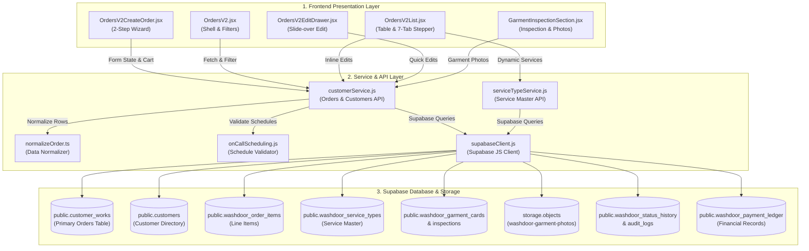
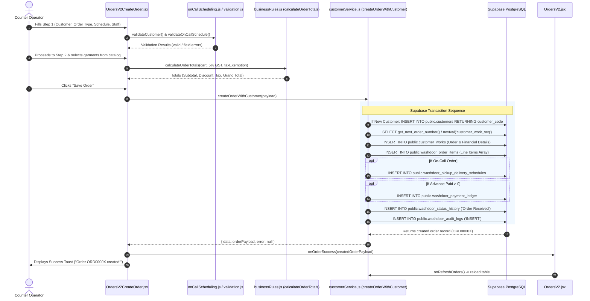
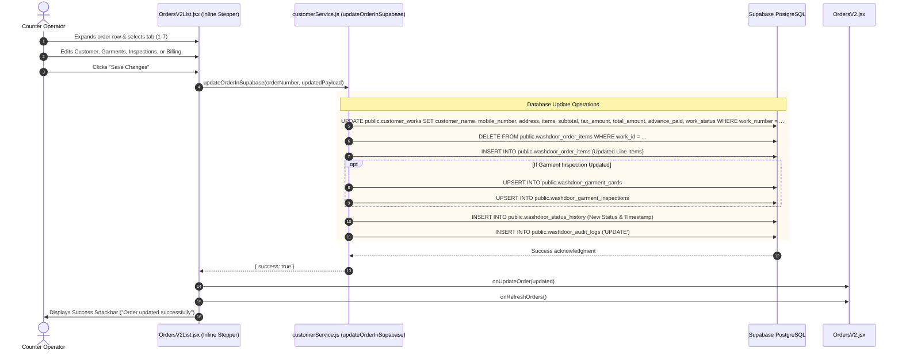
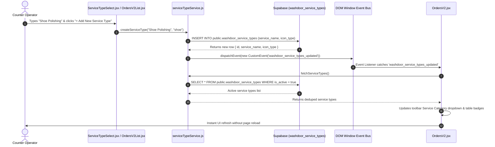
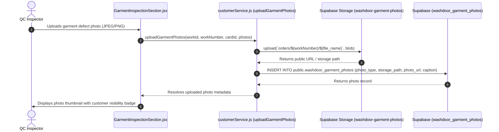

# Orders v2 Architecture – Data Flow & Integration Pipeline

This document details the end-to-end data flow in **Orders v2** across the Frontend UI components, the Service/API layer, and the Supabase PostgreSQL database tables. It covers all lifecycle operations including order creation, querying, normalization, inline editing, dynamic service synchronization, photo uploads, and cascading deletion.

---

## 1. System Architecture Diagram



---

## 2. Order Intake & Creation Pipeline (Step 1 & Step 2)



### Detailed Execution Steps:
1. **Intake Data Gathering (`OrdersV2CreateOrder.jsx`)**: Collects customer selection/mode, order type, scheduled dates/times, attend staff name/ID, pickup driver name/ID, garment cart items, care notes, discount %, tax exemption flag, and advance payment.
2. **Client Validation**:
   - `validateCustomer()` verifies mobile format (`/^[6-9]\d{9}$/`) and required customer name.
   - `validateOnCallSchedule()` ensures pickup is not in the past and delivery is strictly after pickup.
3. **Financial Calculations (`calculateOrderTotals`)**: Computes subtotal, applies discount percentage, computes taxable base, calculates 5% GST (unless tax-exempt), and produces the grand total.
4. **API Invocation (`customerService.createOrderWithCustomer`)**:
   - If a new customer was entered, registers them into `public.customers` and captures the generated customer code.
   - Invokes `get_next_order_number()` to obtain the next sequential order number (`ORD0000X`).
   - Inserts order into `public.customer_works`.
   - Inserts each garment item into `public.washdoor_order_items` with a foreign key back to `work_id`.
   - If On-Call, creates a schedule slot in `public.washdoor_pickup_delivery_schedules`.
   - If advance payment was made, creates an entry in `public.washdoor_payment_ledger`.
   - Appends an immutable lifecycle log in `public.washdoor_status_history` and `public.washdoor_audit_logs`.
5. **Callback & Refresh**: Dispatches `onOrderSuccess`, closes the dialog, displays toast feedback, and triggers `onRefreshOrders()` to reload the live dataset.

---

## 3. Order Query, Normalization & Filtering Pipeline

```mermaid
flowchart LR
    A[("Supabase<br/>customer_works")] -->|getOrders()| B["customerService.js<br/>mapCustomerWorkRow()"]
    B --> C["normalizeOrder.ts<br/>normalizeOrder()"]
    C --> D["OrdersV2List.jsx<br/>restoreOrderPricing()"]
    D --> E["orderStatus.ts<br/>normalizeOrdersV2Status()"]
    E --> F["Filter Engine<br/>(Search, Status, Service, Date)"]
    F --> G["useOrdersPagination.ts<br/>(5, 10, 20, 50, All)"]
    G --> H["Render Table &<br/>4 KPI Summary Cards"]
```

### Detailed Execution Steps:
1. **Query Execution (`getOrders` in `customerService.js`)**:
   - Executes `SELECT * FROM public.customer_works ORDER BY intake_date DESC`.
   - If `customer_works` is unavailable, gracefully falls back to `public.washdoor_orders_master`.
2. **Row Mapping (`mapCustomerWorkRow`)**: Formats DB column names into unified frontend properties (`work_number` -> `order_number`, `work_status` -> `order_status`, `advance_paid` -> `advance_paid`).
3. **Data Normalization (`normalizeOrder.ts`)**:
   - Defensively parses each order object.
   - Coerces missing or `null` values: numbers default to `0`, strings default to `''`.
   - Normalizes customer object, contact details, and items array.
4. **Pricing Restoration (`restoreOrderPricing` in `OrdersV2List.jsx`)**: Ensures item unit prices, quantities, and line amounts match the raw database records without distortion.
5. **Canonical Status Mapping (`normalizeOrderStatus` in `orderStatus.ts`)**: Maps legacy and raw status strings to the 5 canonical UI states:
   - `Order Received`
   - `In Progress`
   - `Ready`
   - `Delivered`
   - `Cancelled`
6. **Multi-Stage Filter Pipeline**:
   - **Status Filter**: Matches against canonical status pills (`All`, `Order Received`, etc.).
   - **Service Filter**: Matches against dynamic keys from `washdoor_service_types`.
   - **Time Range Filter**: Evaluates timestamp against `Today`, `This Week`, `This Month`, or `All Time`.
   - **Search Filter**: Case-insensitive substring match across Order ID, Customer Name, Mobile Number, and Address.
7. **Pagination Slice (`useOrdersPagination.ts`)**: Slices the filtered array into active pages based on `pageSize` (`5`, `10`, `20`, `50`, or `All`).

---

## 4. 7-Tab Horizontal Stepper Inline Edit & Update Data Flow



### Detailed Execution Steps:
1. **User Edit**: The operator makes updates across any of the 7 tabs:
   - Tab 1: Updates customer name, phone, or delivery address.
   - Tab 2: Adds/removes garments, changes services, adjusts rates/quantities.
   - Tab 3: Logs garment defects, stains, fabric make, or finish preferences.
   - Tab 4: Changes laundry processing stage or rack location.
   - Tab 5: Records payments, adjusts discounts, or changes payment modes.
2. **Save Request (`updateOrderInSupabase`)**: Dispatches the modified payload to `customerService.js`.
3. **Database Mutation**:
   - Executes an `UPDATE` on `public.customer_works` matching by `work_number` or `work_id`.
   - Re-synchronizes `public.washdoor_order_items` to reflect updated garment quantities and amounts.
   - If garment inspection cards exist, upserts records in `public.washdoor_garment_cards` and `public.washdoor_garment_inspections`.
   - Records audit entries in `public.washdoor_status_history` and `public.washdoor_audit_logs`.
4. **UI Synchronization**: Triggers `onUpdateOrder`, collapses/maintains row state, displays a success snackbar, and refreshes the order table.

---

## 5. Dynamic Service Types Synchronization Data Flow

Orders v2 allows operators to create new service categories on-the-fly from the Order Details tab. The application synchronizes dynamic services using Supabase database triggers and browser CustomEvents:



---

## 6. Garment Inspection & Photo Upload Data Flow

When taking photos of damaged garments or stubborn stains in Tab 3 (Garment Inspection):



---

## 7. Order Deletion Data Flow

When an operator clicks the Delete icon in the Actions column:
1. **User Confirmation**: Displays browser confirmation dialog: `"Are you sure you want to delete this order?"`.
2. **API Execution (`deleteOrderFromSupabase`)**: Calls `customerService.js` with order ID/work number.
3. **Database Cascade**:
   - `DELETE FROM public.customer_works WHERE work_id = ... OR work_number = ...`.
   - PostgreSQL `ON DELETE CASCADE` foreign keys automatically delete associated records in `washdoor_order_items`, `washdoor_garment_cards`, `washdoor_garment_inspections`, `washdoor_pickup_delivery_schedules`, and `washdoor_payment_ledger`.
4. **Audit Logging**: Appends a `DELETE` operation entry to `public.washdoor_audit_logs`.
5. **State Update**: Calls `onDeleteOrder(id)`, displays `"Order deleted successfully"` snackbar, and calls `onRefreshOrders()` to update table counts and KPI cards.
